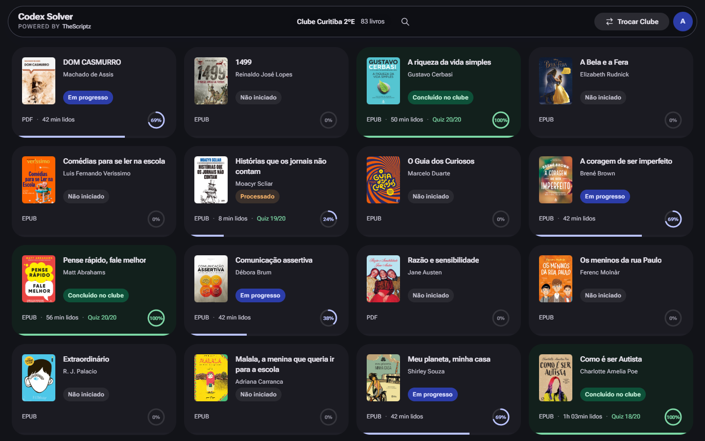

# Leia Paraná Hack

**Painel Codex Solver.** Completa livros do clube de leitura do Leia Paraná: leitura, quiz e devolução, no nosso servidor.

[Site](https://thescriptz.fun) · [Landing](https://thescriptz.fun/leia-parana-hack) · [Instalar](https://thescriptz.fun/instalar) · [Planos](https://thescriptz.fun/planos)

## O que é

O Leia Paraná Hack é o painel dedicado do TheScriptz para o Leia Paraná. O Codex Solver lista todos os livros do seu clube e completa cada um do começo ao fim: pega o livro emprestado, simula o tempo de leitura página por página, responde o quiz de compreensão e devolve. Tudo roda no nosso servidor, então você pode fechar a aba.

Funciona com epub e PDF, no computador e no celular, com o login escolar `@escola.pr.gov.br`.

## Recursos

- Completa o livro inteiro: empréstimo, leitura, quiz e devolução
- Roda no servidor — pode fechar a aba que continua
- Suporte a epub e PDF, com o formato marcado em cada livro
- Dois ritmos: Rápida (poucos minutos) ou Realista (tempo cheio registrado)
- Banco de gabaritos próprio que aprende a cada livro concluído
- Segunda tentativa automática quando o quiz permite
- Busca por título ou autor entre os livros do clube
- Progresso, tempo lido e nota do quiz na mesma tela

## Como usar

1. Escolha um plano em [thescriptz.fun/planos](https://thescriptz.fun/planos).
2. Instale o bookmark em [thescriptz.fun/instalar](https://thescriptz.fun/instalar).
3. Entre em `leiaparana.odilo.us` com seu login escolar.
4. Clique no bookmark na página inicial — o painel Codex Solver abre sozinho.
5. Escolha o livro, o ritmo e clique em "Completar Livro".

## Perguntas frequentes

**Preciso deixar a aba aberta?**
Não. O Codex Solver roda no nosso servidor; depois de clicar em "Completar Livro" você pode fechar a aba e voltar depois.

**Qual a diferença entre os ritmos Rápido e Realista?**
No Rápido o livro é concluído em poucos minutos, com pouco tempo de leitura registrado. No Realista o tempo é registrado por inteiro, página por página. Nos dois casos o quiz é respondido automaticamente.

**O painel acerta o quiz de compreensão?**
Ele consulta o banco de gabaritos do TheScriptz, usa a resposta que a própria plataforma revela quando disponível e recorre à IA no restante. Quando a questão permite segunda tentativa, reenvia com a resposta correta.

**Funciona com PDF ou só epub?**
Com os dois. O painel identifica o formato e ajusta a simulação de leitura para o leitor certo.

## Planos e preços

| Plano | Preço | Período |
|---|---|---|
| Semanal | R$ 5,97 | 7 dias |
| Mensal | R$ 14,97 | 30 dias |
| Trimestral | R$ 34,97 | 90 dias |
| Anual | R$ 119,97 | 365 dias |

Todos os planos incluem o bookmark e os painéis disponíveis. Pagamento via Pix; renovar antes do vencimento soma o novo período ao tempo restante.

## Links

- **Site oficial:** [thescriptz.fun](https://thescriptz.fun)
- **Landing Leia Paraná:** [thescriptz.fun/leia-parana-hack](https://thescriptz.fun/leia-parana-hack)
- **Instalar:** [thescriptz.fun/instalar](https://thescriptz.fun/instalar)
- **Planos:** [thescriptz.fun/planos](https://thescriptz.fun/planos)
- **Perfil no GitHub:** [github.com/thescriptz](https://github.com/thescriptz)
- **Suporte:** [WhatsApp](https://wa.me/5562981046894)

## Aviso

O código-fonte do TheScriptz é privado. Este repositório contém apenas informações públicas do produto.

O TheScriptz é independente e não possui vínculo com a Odilo, o Governo do Paraná ou a Secretaria de Estado da Educação do Paraná.
